# Presentation outline: Mining for Meaning

Slide overview for the talk in [cfp.md](cfp.md). 
| | |
|---|---|
| **Talk** | Mining for Meaning: A Knowledge Layer for Agents |
| **Strategy** | ONE complete master deck (all 31 slides); each talk is cut from it by audience and available time (see "Cutting the deck") |
| **Slot** | the CFP is 30 minutes with a live demo; other lengths are cut from the master deck |
| **Audience** | multiple; the structure and demo are fixed and the examples are adapted (see the end) |
| **Product naming** | Neo4j is named from the architecture slide on |
| **Game naming** | the game is **not named until the reveal slide (21)**; see "The naming rule" below |

## The four takeaways

Every slide serves one of these. The closing slide repeats them.

1. **When** a knowledge layer is the right choice for agents, and when it is not.
2. **The three parts** (ontology, data, memory) and where the agent's tools sit relative to them.
3. **A graph structure** that works: domain, lexical and bridge, with candidate versus confirmed knowledge.
4. **How to build and test it**: source-of-truth loaders, a spec checked against the graph, tests for the agent.

## The naming rule

The slides show the game's items and art (a diamond sword, ore, a crafting table) but never name the game, and never use game words in text before the reveal. Those who know it will recognise it; everyone else reads a company, its products and its processes, and draws their own parallels. Say nothing false: MineCorp is "a fictional company", and the abstract (which does name the game) stays as it is.

| Instead of | Write |
|---|---|
| players | workers, employees |
| the game, the server, Minecraft client | the system, the client |
| mobs, creatures | sources, suppliers (or "creatures" under a picture) |
| crafting, smelting | making, processing (the item names stay) |
| the Nether, the Ender Dragon | the end-game goal, a multi-stage objective |
| enchantments | upgrades (the word is fine under a picture, never explained) |
| in-game book | a panel the worker opens |

Screenshots that show the game (the chat, the book, the world) wait until the demo. Before it, use cropped item art, diagrams and Neo4j views.

## Cutting the deck

The master deck is complete and is not shortened to fit a slot. For each talk, hide (do not delete) the slides that do not serve that audience or time. Keep slide numbers in the master so a cut is a list of numbers.

**Core slides, in every version:** 1, 2, 3, 4, 5, 7, 8, 9, 12, 13, 18, 21, 22, 30 (title, welcome, hook, use case, the complexity, the three parts, the graph map, one process, the reveal, the demo, the takeaways).

**Add by audience:**

| Audience | Add to the core |
|---|---|
| Developers | 11, 23, 24, 25, 26, 27, 28, 29 (architecture, rebuild, spec test, tools, sources, tests, failures, interim results) |
| Architects | 6, 10, 14, 15, 16, 17, 19, 20, 23, 24, 29 (sources, why a graph, each graph, memory, rebuild, spec, interim results) |
| Technical leaders | 6, 14, 15, 16, 17, 19, 20, 26, 29 (sources, the graphs and their business parallels, evidence, interim results) |

**By time:** with less time, drop add-ons from the end of the list first; with more, use them all and extend the demo (every step in slide 22). The demo steps are also cuttable: 1, 3 and 5 are the minimum.

---

## Part 1. The hook (takeaway 1)

### 1. Title

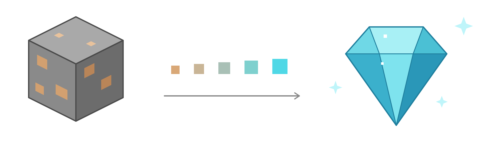
- Mining for Meaning: A Knowledge Layer for Agents
- **Visual:** a block of ore turning into a diamond (the image for slide 4 in miniature).

### 2. Welcome
Hi, I'm Martin
- Name, role, contact.

### 3. The hook
- **"Agents are only as reliable as the knowledge they can reach."**
- **Visual:** the sentence alone, large.

### 4. The use case: MineCorp

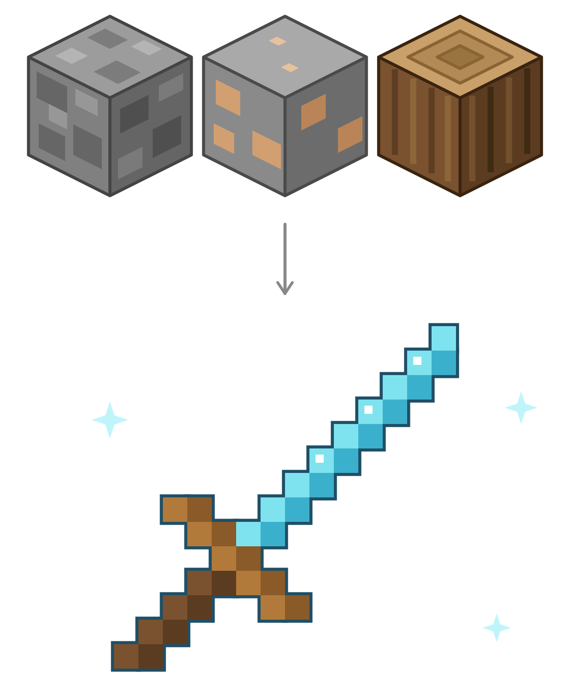
- A company that turns raw materials into finished products.
- Workers ask an agent questions: what do I need, where do I find it, what is the way to X.
- The game is not named.
- **Visual:** the image of raw materials (cobblestone, iron ore, a log) on the left, a diamond sword on the right, an arrow between them.

### 5. Three ways to give an agent knowledge, and where they break

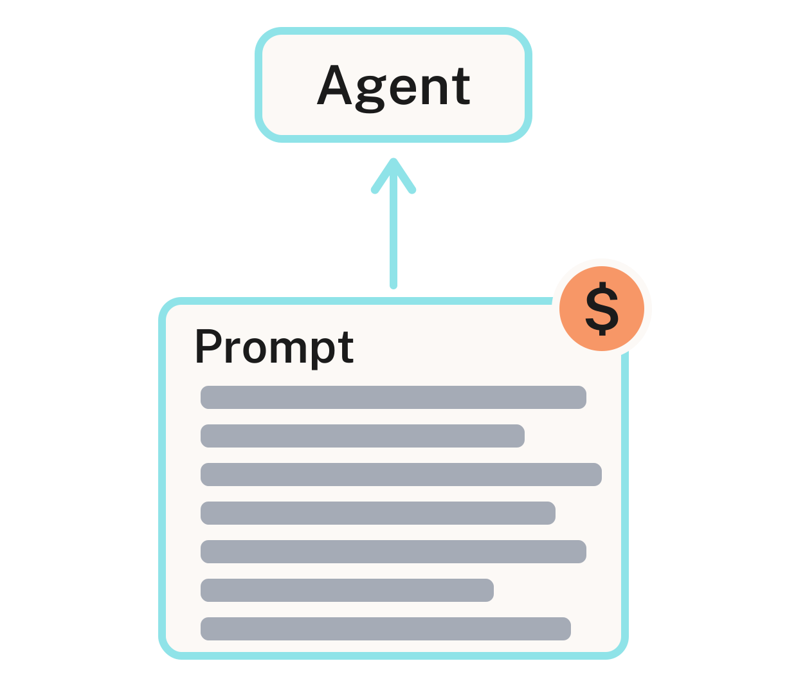
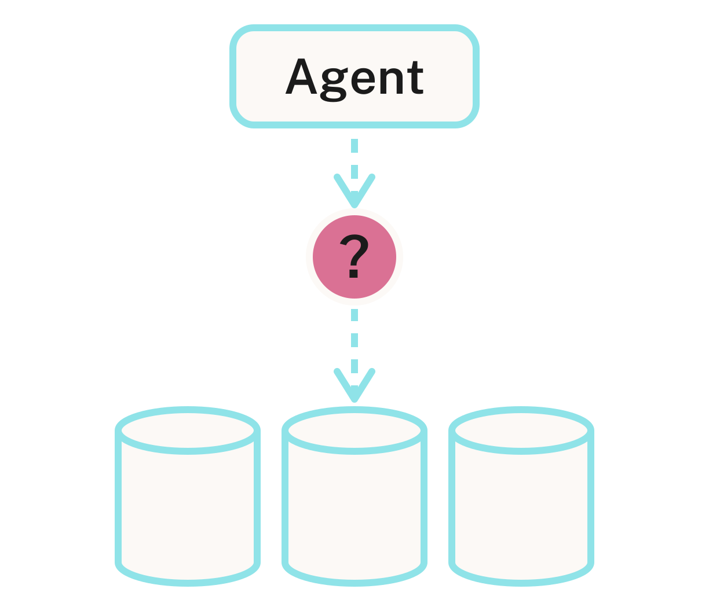
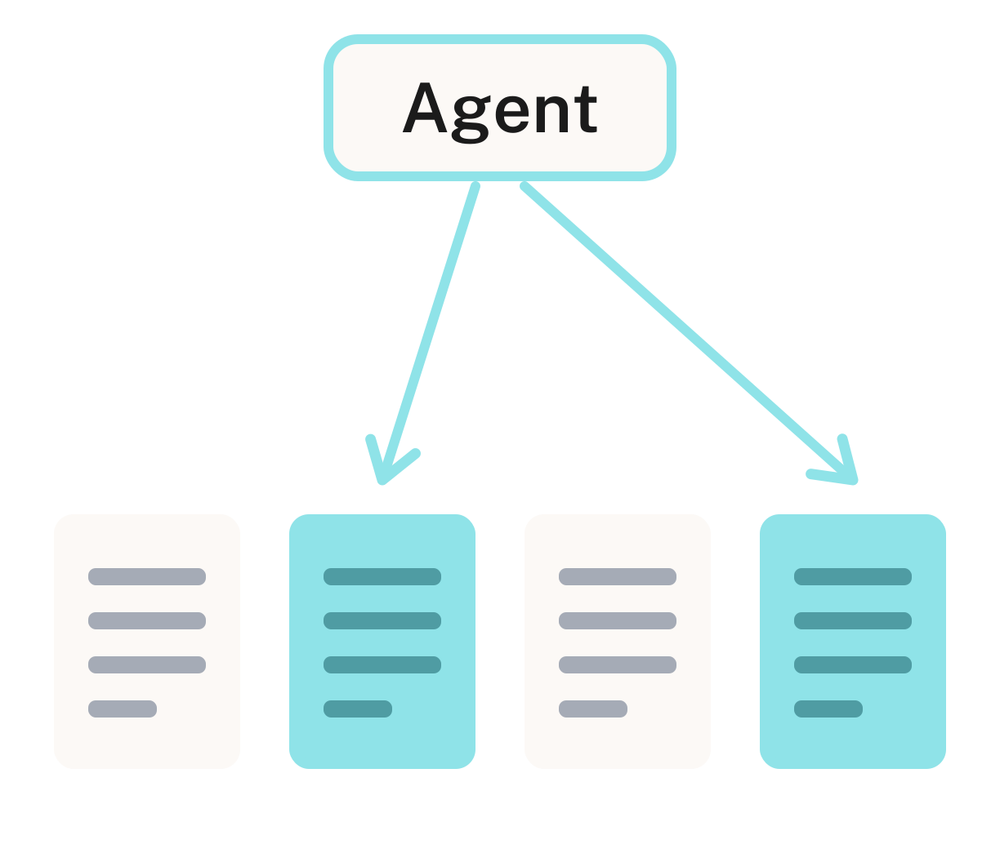
- **Everything in the prompt:** expensive and stale.
- **Free rein over the databases (text-to-query):** the agent guesses what your schema means.
- **Retrieval on its own:** only finds passages, but not how things connect.
- **A knowledge layer:** the alternative, built up over the next slides. It is not always worth it (said on the closing slide, 30; slide 29 shows interim numbers for what it buys).
- **Visual:** three small diagrams, each with the failure written under it. The fourth is left blank on purpose and filled in later.
- Source of the comparison: the CFP checklist says the demo must back this up with a real comparison.

## Part 2. The knowledge layer: sources and the complexity (takeaway 1 and 2)

### 6. What does MineCorp know? The sources


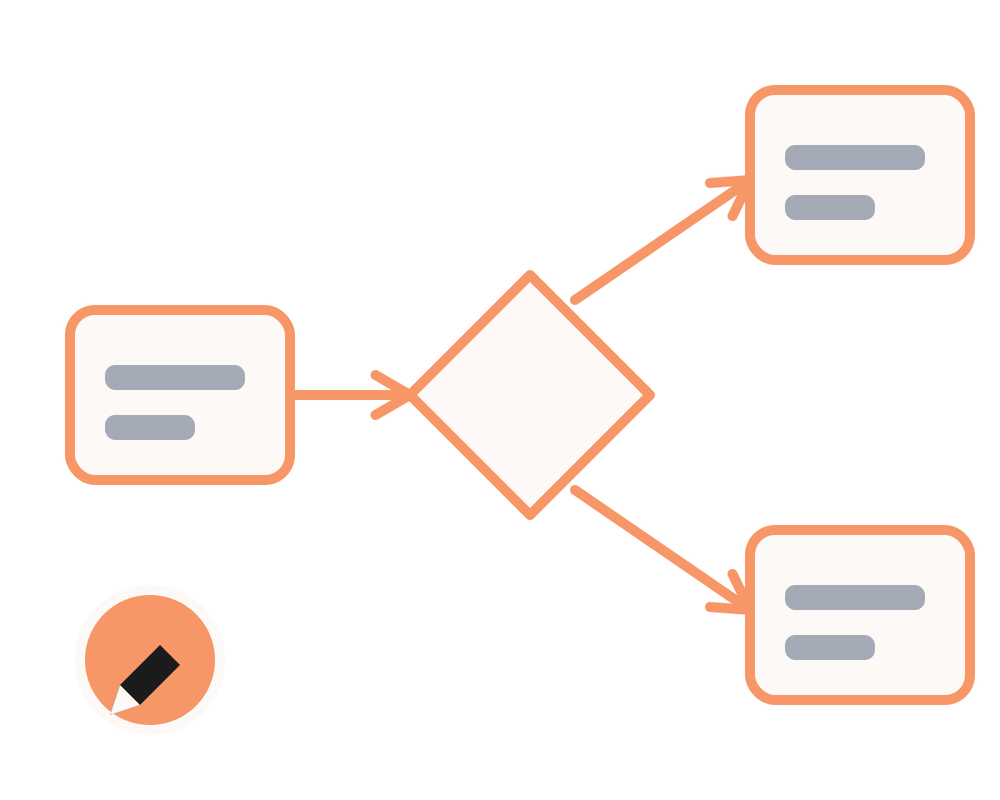

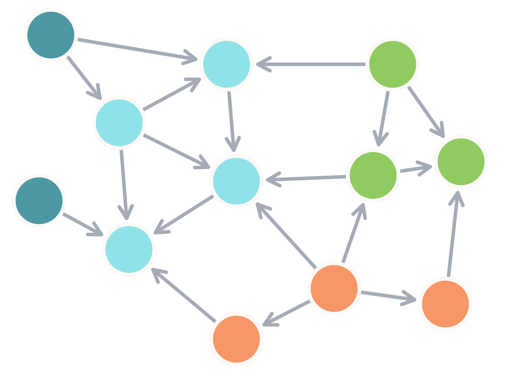
- The system of record (in the demo it turns out to be the game server's own data files): recipes, suppliers, locations, raw materials, trades, upgrades. Authoritative. The part in brackets is for the notes only, not the slide.
- The community wiki: advice, strategy, how things work. Written by people, can be wrong.
- Defined processes: setting up a first shelter, earning a scarce currency, and the long multi-stage goals. Not in the data anywhere, so authored.
- The agent's own memory: what each worker asked and what the agent did.
- **Visual:** four sources on the left, one graph on the right.

### 7. Reveal the complexity: nothing to a diamond sword

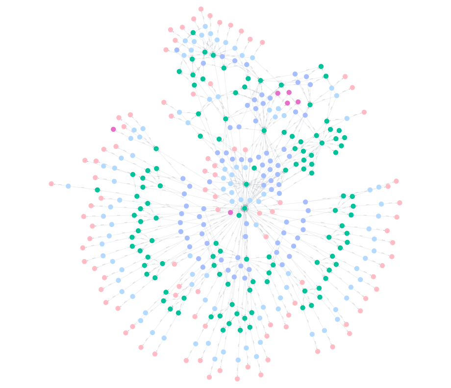
- Show one item and everything that leads to it: every recipe, every alternative ingredient, every station, every place to extract, harvest or trade for each piece.
- **Visual (the centrepiece of this part):** the graph of all possible routes from nothing to a diamond sword, drawn from the real database in Neo4j Browser or Bloom. It should look too big to hold in your head.
- **The query** (paste into Neo4j Browser; read-only; Cypher 25). It collects everything that can lead to a Diamond Sword, level by level without repeats, then returns the graph among those nodes:

```cypher
CYPHER 25
MATCH (t:Item {name: 'Diamond Sword'})
WITH reduce(seen = [t], depth IN range(1, 30) |
  reduce(u = seen, n IN
    reduce(acc = [], x IN seen |
      acc
      + [(x)<-[:CREATES]-(m) WHERE m:Recipe OR m:Mine OR m:Kill OR m:Shear | m]
      + [(x)-[:REQUIRES|USES_STATION]->(y) | y]
      + [(x)-[:INCLUDES]->(y) | y]
    )
  | CASE WHEN n IN u THEN u ELSE u + n END)
) AS nodes
MATCH (a)-[r:CREATES|REQUIRES|USES_STATION|INCLUDES]->(b)
WHERE a IN nodes AND b IN nodes
RETURN a, r, b
```

- Measured on the development database (2026-11-13): **396 nodes** (79 recipes, 99 mine, kill or shear actions, 119 items and categories, the rest blocks and mobs) and **555 relationships**; the result is the same at 15 and at 30 levels, so it has settled. Re-count on the final database before quoting these.
- Leaves out: villager trades (they would pull in the emerald economy) and the thin Craft and Smelt actions (they duplicate the recipes). Add `OR m:Trade` to the maker filter to include trades.
- **Routes cannot be listed, but they can be counted.** A path search for the routes ran the database out of memory at 12 levels (the number of routes is too big to enumerate), so they were counted by dynamic programming instead (a script, read-only, 1.5 seconds, 1,607 states). On the development database (2026-11-13) the Diamond Sword has about **5.7 x 10^145** recipe trees (a 146-digit number).
  - The counting rule: an item is made by any one of its makers; a maker needs all its requirements (ingredients, the tool, and the station unless the 2x2 grid will do); a category is any one of its members; blocks and mobs are leaves; nothing may need what it is making; villager trades are left out. Each time an item is needed its way is chosen again, so this counts trees, not consistent plans, and **overstates the number of distinct plans**. The "or better" tools are not counted as alternatives (which understates it).
  - So say it as a rule, not a fact about the game: "more than 10^100 ways under a simple counting rule", and expect to be asked how it was counted. Safer still: quote the 396 nodes and 555 relationships and say the routes cannot be listed.
- To prepare: in Browser, colour by label, size the nodes and switch off the labels so it reads as one mass; keep one close-up (the sword, diamond and stick) for the next slide.
- Hardest items for contrast: glazed terracotta (8 steps), netherite tools (7 steps), from `rank_recipes`. (Notes only; if used on a slide, say "the hardest finished products", not the item names, before the reveal.)
- Slide wording: describe the 396 nodes as "recipes, gathering actions, products and materials", not "mine, kill or shear" and "mobs". In Browser, caption the action nodes "gather" if the default captions ("Mine Deepslate Diamond Ore") are too revealing.

### 8. Reveal the complexity: nothing to a diamond sword

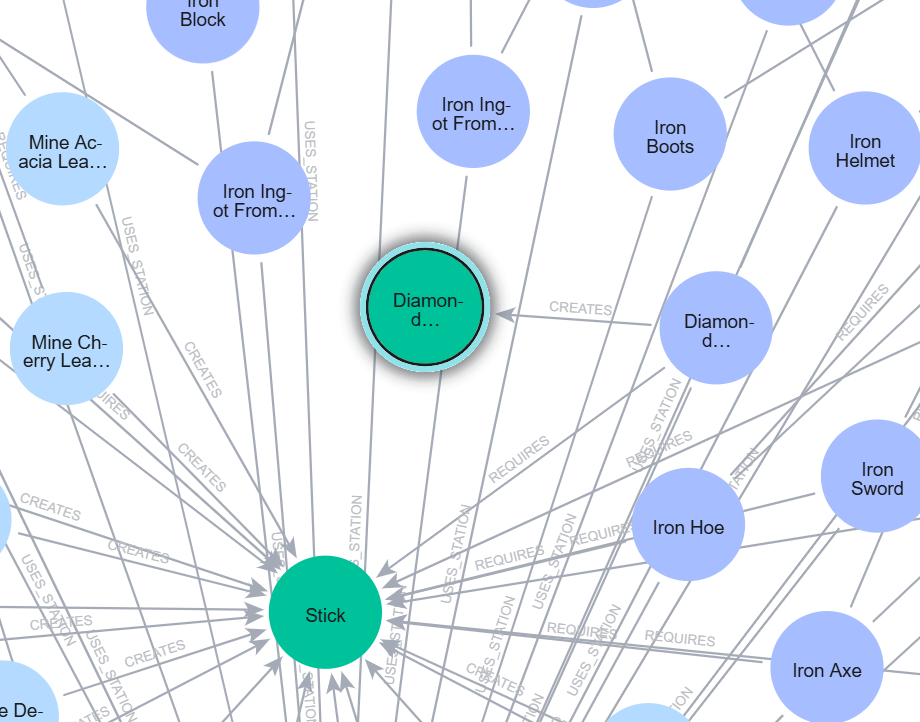

- Zoom in on the diamond sword node
- The diamond sits as an end node within the graph, created by, the Diamond Sword recipe

### 9. Reveal the complexity: nothing to a diamond sword

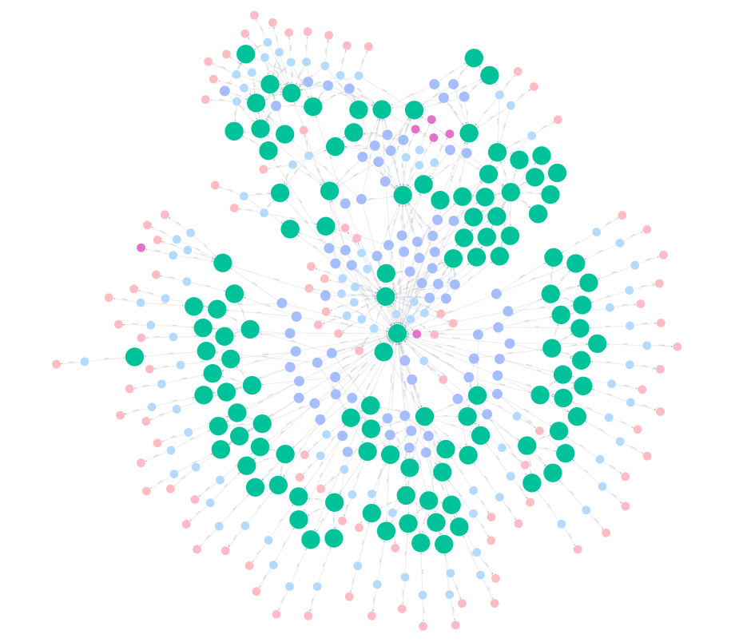

- Same complex graph with the Item nodes 
- The larger nodes are items, the complexity doesn’t come from the “happy” or usual path some diamond + a stick for the handle = diamond sword, it comes from all the other possible combinations (unhappy paths) which are often not catered for in the agentic systems leading to hallucination and incorrect responses.

### 10. Why a graph

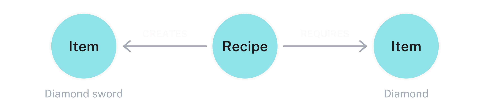
- The question is about paths and connections ("what do I need", "where do I find"), not rows.
- The same facts from several angles: a product is a recipe's result, another recipe's ingredient, a by-product, a trade, a raw material.
- **Visual:** the diamond sword reduced to one path, `(Item)<-[CREATES]-(Recipe)-[REQUIRES]->(Item)`, so the audience sees the notation used in the demo.

## Part 3. Architecture (takeaway 2)

### 11. The shape of the solution

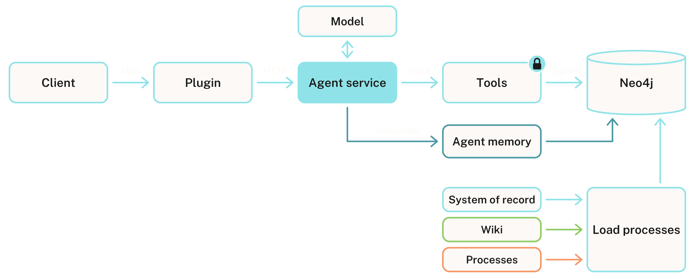
- Client -> thin plugin -> agent service -> read-only tools -> Neo4j.
- The plugin only forwards the question and opens the answer.
- The agent has a hand-written tool loop over a model, with no framework.
- **Visual:** the line diagram from the README, redrawn with neutral labels (no "Minecraft client", no "Paper server").

### 12. The three parts of a knowledge layer, and where the tools sit

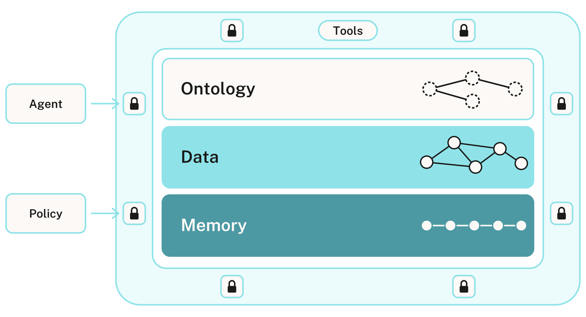
- **Ontology** (the model), **data** (instances of the model), **memory** (decision traces).
- The knowledge layer is the graph. The tools, the policy and the agent are the access layer outside it.
- Read-only purpose-built tools are the access control.
- **Visual:** the graph as a box with three layers inside; the tools drawn around it as a ring.
- Source: [knowledge-layer.md](knowledge-layer.md), [architecture.md](architecture.md).

## Part 4. The graph structure (takeaway 3)

### 13. Three graphs

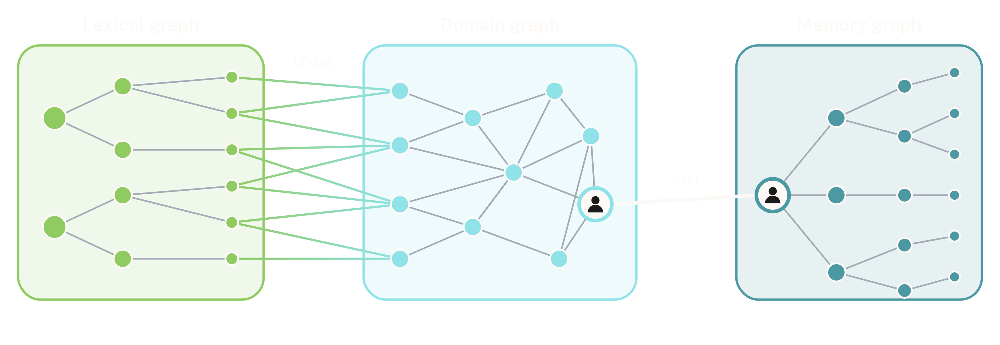
- **Domain graph:** known, authoritative, from the system's own data and authored files. Business parallel: the catalogue and the bill of materials.
- **Lexical graph:** inferred, from the wiki; sections and embedded chunks. Business parallel: the documentation.
- **Memory graph:** what happened, the conversations and the trace of every answer. Business parallel: the audit trail.
- **Two kinds of link between them:**
  - **The bridge** (domain to lexical): derived links from wiki passages to the products, suppliers and materials they mention.
  - **The worker** (memory to domain): each memory belongs to a worker who is also in the domain graph.
- Say plainly that the full join is the direction of travel, not what is built: memory has no links to the lexical graph, and linking what the agent learns (long-term entities) to domain nodes is not built. Do not call the bridge a link between all three.
- **Visual:** three graphs in three colours used on every later slide: a band of links between domain and lexical (the bridge), and a single thread from memory to domain (the player).

### 14. The domain graph: where it comes from

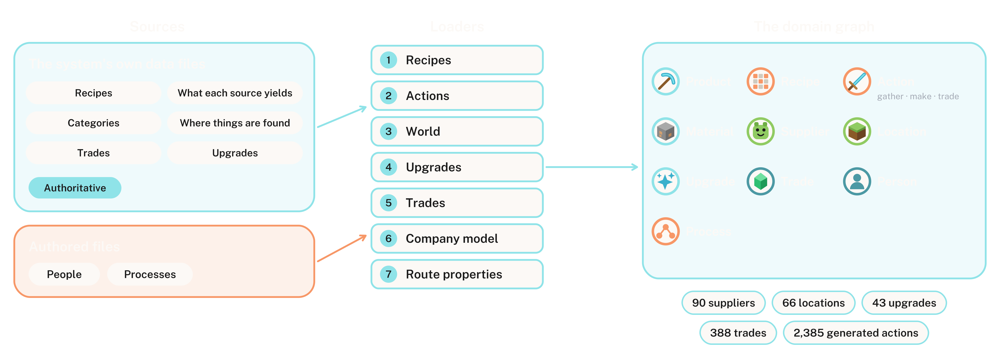
- Products, recipes, gathering, yields, suppliers, locations, trades, upgrades.
- Loaded from the source of truth, never typed by hand.
- **Business parallel:** where a catalogue's data comes from: the system of record, loaded, not retyped.
- **Visual, where the domain data comes from** (a diagram, not a graph). Left to right: **sources, loaders, graph**. It sets up "never typed by hand", and the next slide zooms into the graph on its right.
  - **Sources (two kinds, never typed into the graph by hand):**
    - **The system's own data files**: recipes, what each source yields, categories, where things are found, trades, upgrades. Authoritative. (In the notes only: this is the server's data, read from its jar. Do not write that on the slide.)
    - **Authored files** (`model/*.yaml`): the worker and the processes. A person writes these, and they stay candidates until confirmed.
  - **Loaders** (one per kind of data, run in a fixed order): recipes, actions, locations, upgrades, trades, the company model, then route properties. Say "a loader per source", not the script names.
  - **The domain graph** at the right, with its kinds of node as small icons and neutral labels: products, recipes, actions (gather, make, trade), suppliers, materials, locations, upgrades, trades, people and processes. Draw the icons from the real item art (a pickaxe, an ingot, an ore block) and leave the game words off the labels.
  - Numbers you can put on it (from the decisions log; recheck on the database you present from), with neutral labels: 90 suppliers, 66 locations, 43 upgrades, 388 trades, 2,385 generated actions. (Game terms for the notes: mobs, biomes, enchantments, villager trades.)
  - Say one thing about it: the graph can be rebuilt from these sources at any time, which is what lets you trust it (slide 23 shows how).
  - Naming: before the reveal call the source "the system's own data files", not "the server jar" or the game's name, and use the neutral labels above (the table in "The naming rule" has the rest).

### 15. The domain graph: a real piece of it

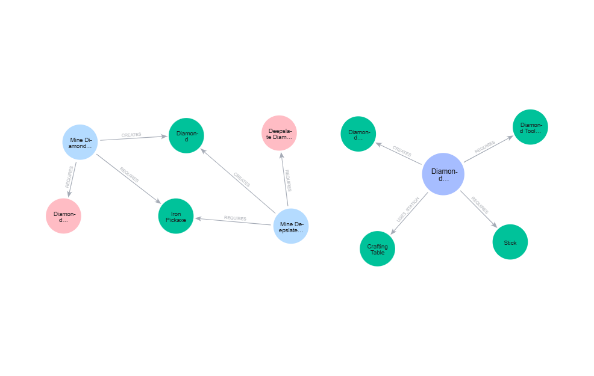
- Products, recipes and gathering as one connected graph, read like a bill of materials.
- **Business parallel:** the product catalogue and the bill of materials, from finished product down to raw material.
- **Visual, a real piece of it:** one small, real piece of the domain graph, read from left to right as a product's bill of materials down to where the raw material comes from: the Diamond Pickaxe, the recipe that makes it, its parts (Diamond, Stick) and its station (Crafting Table), then how the Diamond is gathered (from two kinds of source, with the tool needed). 11 nodes, so every label can be read. Colour by kind (item, recipe, action, block) and caption the relationships (CREATES, REQUIRES, USES_STATION). Put a plain-words key beside it: product, process, part, source.
  - Query (read-only, checked on the development database: 11 nodes, 7 paths):

```cypher
MATCH p = (:Item {name: 'Diamond Pickaxe'})<-[:CREATES]-(:Recipe)-[:REQUIRES|USES_STATION]->(:Item)
RETURN p
UNION
MATCH p = (:Item {name: 'Diamond'})<-[:CREATES]-(:Mine)-[:REQUIRES]->()
RETURN p
```

  - **Use it live** (a short demo in Browser, in place of or beside the image).
    - Prepare: save the query as a Browser favourite, apply the node colours and captions beforehand, and open the tab before the talk. Keep a screenshot of the finished result on a hidden slide as the fallback (no network, no database).
    - Keep it to about a minute: run it, point at the product, the process, the parts and the source, expand one node, then go back to the slides. The same tab is reused at the demo (slide 22, step 7).
    - Before the reveal, the live Browser shows item names only, so it fits the naming rule.
  - "Diamond Tool Materials" is a category (any one of several items); it is worth a callout because it shows the model handling "any of these".

### 16. The lexical graph: where it comes from

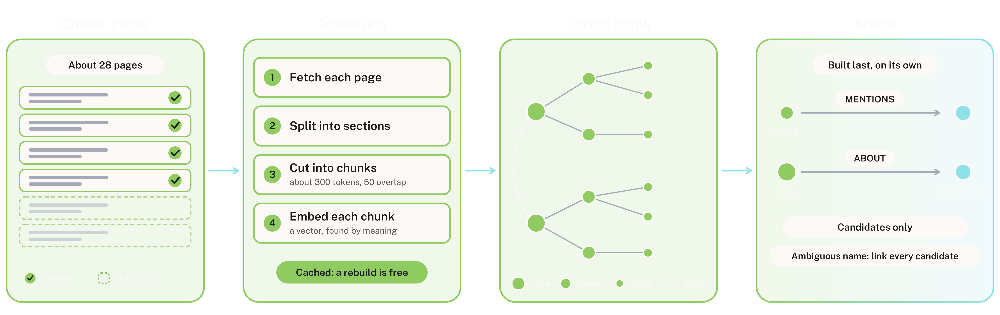
- Wiki pages split into sections and chunks, embedded for vector search, linked to the nodes they are about.
- A link is evidence; no link says nothing. Ambiguous names link to every candidate and the model chooses from the passage.
- **Business parallel:** internal documentation, wikis and tickets, connected to the product data.
- **Visual 1, where the lexical data comes from** (a diagram; as on slide 14). Left to right: **chosen pages, processing, lexical graph, then the bridge**.
  - **Chosen pages:** a short list of community wiki pages that a person reviewed and picked (about 28 in `model/wiki_pages.yaml`; recheck). Say that the choice is a decision, not a crawl: pages held back are held back on purpose, so one big page cannot drown the others.
  - **Processing:** fetch each page, split it into sections, cut each section into passages (chunks of about 300 tokens, overlapping by 50), and turn each passage into an embedding (a vector of numbers) so it can be found by meaning. Embeddings are cached, so a rebuild is free.
  - **The lexical graph:** pages, sections, passages and the links between wiki pages, kept as graph (a page's own links, and redirects, are relationships).
  - **The bridge, built last:** a separate step scans each passage for the names of things in the domain graph and links the passage to them (`MENTIONS`), and the page to what it is about (`ABOUT`). Candidates only: a person can correct them in a fixes file, and an ambiguous name links to every candidate.
  - Colour: use the lexical colour for the first three boxes and the bridge colour for the last, so the next visual's join is already familiar.
  - Naming: say "the community wiki", not the game's wiki name, before the reveal.

### 17. The lexical graph and the bridge: a real passage

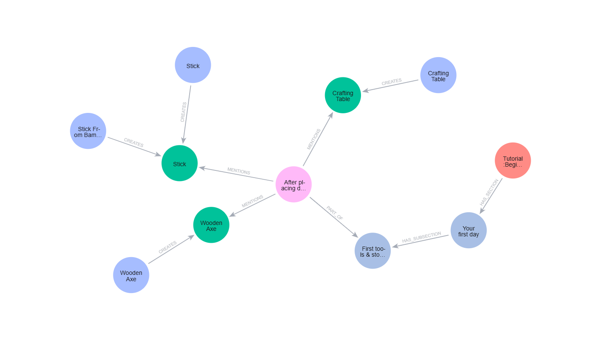
- One real passage, joined by the bridge to the products it is about: the document, and the product it describes.
- **Business parallel:** a wiki or ticket page linked to the catalogue entries it mentions.
- **Visual, a real passage, with the bridge:** one real passage with the bridge drawn across to the domain graph, left to right: page, section, passage (chunk, shown with a strip of numbers for its embedding), then the bridge links (`MENTIONS`) to three items, then each item's recipe on the domain side. In the lexical colour on the left, the domain colour on the right, with the bridge links in a third colour so the join is the thing the eye finds. Example: the wiki page "Beginner's guide", the section "First tools & stone", one passage, and the items Crafting Table, Stick and Wooden Axe.
  - Query (read-only, checked on the development database: 1 section path, 3 mentions, 4 recipe paths):

```cypher
MATCH ps = (pg:Page {title: "Tutorial:Beginner's guide"})-[:HAS_SECTION|HAS_SUBSECTION*1..2]->(s:Section {title: 'First tools & stone'})<-[:PART_OF]-(c:Chunk {index: 17})
MATCH pm = (c)-[:MENTIONS]->(n)
WHERE n.name IN ['Crafting Table', 'Stick', 'Wooden Axe']
OPTIONAL MATCH pr = (n)<-[:CREATES]-(:Recipe)
RETURN ps, pm, pr
```

  - This query can be run live in Browser as it is (it draws the same graph as any other way of returning the paths). Same preparation as slide 15: favourite, colours and captions set, tab open, screenshot as the fallback. The chunk's `index` is only unique within a page, which is why the query fixes the page first.
  - In Browser, set the passage caption to its `index` (its text and embedding are long) and the page caption to `title`.
  - The point to make on the slide: the wiki passage and the recipe are different kinds of knowledge, joined because both are about the same item. Say it in words: "the document, and the product it describes".

### 18. The process graph: the unknown part

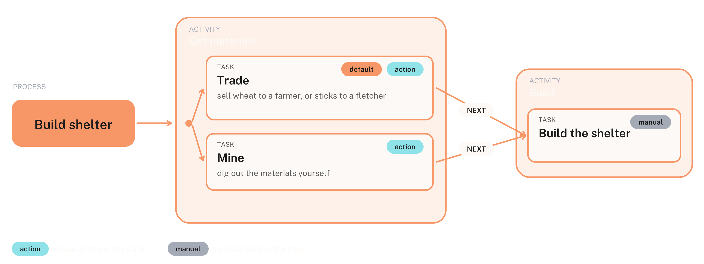
- A process holds what the data does not: a goal (Process), its stages (Activity), its steps (Task), with `NEXT` carrying the alternatives.
- Steps name real actions where the data has them; the rest are manual.
- **Candidate versus confirmed:** a drafted process is a candidate (source, confidence) until a person confirms it.
- **Business parallel:** runbooks and standard operating procedures; LLM-extracted knowledge waits for human approval.
- **Visual:** the "build shelter" process as a small flow with a branch: trade (the default: sell wheat to a farmer or sticks to a fletcher) or mine. It needs no game words. (The Nether portal process is saved for the demo.)

### 19. Memory: three kinds

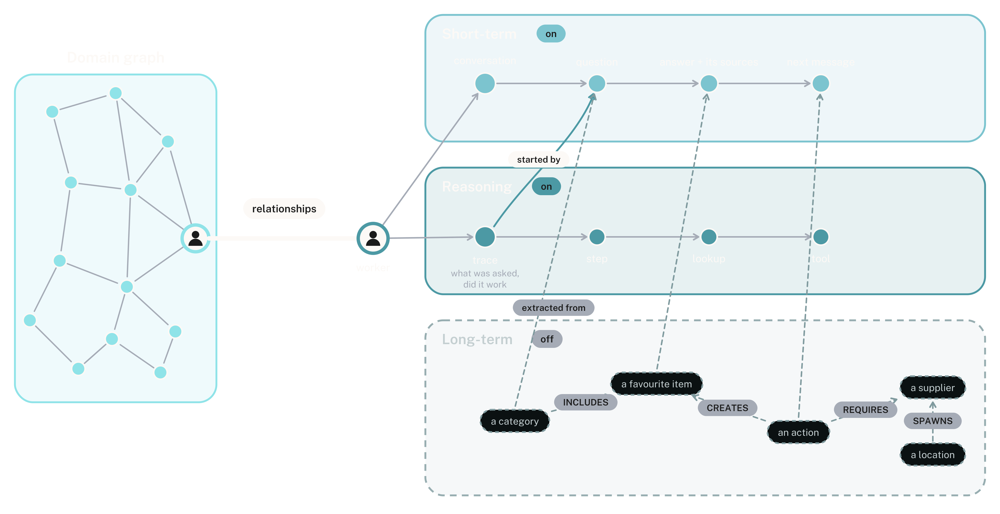
- Memory is a graph of its own, written by the agent library, and it holds three kinds of memory. Two are on today; the third is built but switched off.
  - **Short-term (on):** the conversation: each question and answer, in order. It is what the agent replays to resolve "it" and "those", and what the explain book is built from. The answer's sources travel with it.
  - **Reasoning (on):** the decision trace: for every run, what was asked, each step, which tool was called, and whether it worked, failed runs included. This is the audit trail.
  - **Long-term (off, a setting):** facts and preferences an LLM finds in what workers say, kept as entities linked to the messages they came from. Say plainly that it is not switched on in the demo.
- The memory graph joins the domain graph at one point only: `(User)-[:IS_PLAYER]->(Player)`. Say so. Linking long-term entities to the domain (a remembered preference to an item) is the planned next link, not built.
- **Business parallel:** short-term is the case file of the current ticket; reasoning is the audit log (who asked what, and why the system answered as it did); long-term is the customer profile that builds up over time.
- **Visual (three layers):** one diagram, the worker at the centre, three memory layers fanning out, and the domain graph at the edge.
  - Centre: the worker (caption "worker"; the node's labels are User and Player, leave that for the demo), joined to the domain graph's worker node by the one link, drawn heavy and labelled "the only join today".
  - Layer 1, short-term (solid): worker → conversation → message → next message → next message, a chain. Caption on the first message: "question"; on the second: "answer + its sources".
  - Layer 2, reasoning (solid): worker → trace ("what was asked, did it work") → step → tool call → tool, with the trace also pointing back at the message that started it. This is the one that links the two layers: the trace is tied to the question.
  - Layer 3, long-term (dashed and greyed, labelled "off"): entity nodes ("a preference", "a favourite item") with dashed links back to the messages they came from, and one dashed link to a domain item marked "planned".
  - Colours: memory layers in one family (three shades), domain in its own colour, so the join reads as the crossing point.
  - Use item names for the trace's tool calls ("how to get", "where to find") only after the reveal; before it, caption them "lookup".

### 20. Memory: a real conversation and its trace

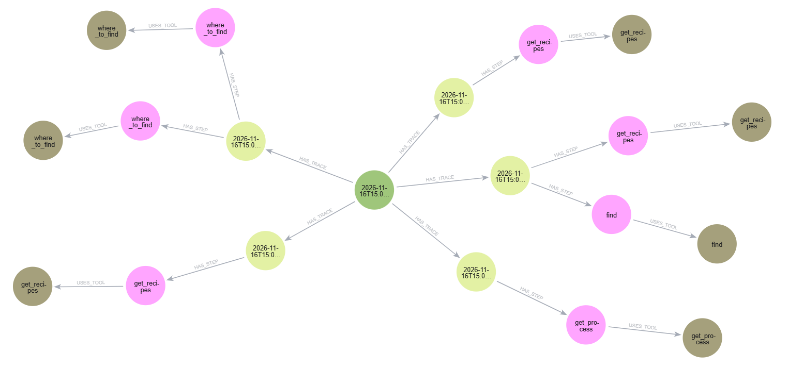
- A conversation, the question and answer in order, with the trace of the tools each answer used, linked to the worker.
- **Business parallel:** the ticket and its audit log, side by side.
- **Visual:** the real graph in Browser (or a screenshot of it), the worker joined to a conversation and to its traces. Item names only before the reveal.
- **Query (read-only; needs memory written to the same database, which is the default; run it after asking a question or two):** the latest conversation, its messages, and the trace of each answer. Check it on the development database before using it live (the relationship names come from the library: `HAS_CONVERSATION`, `HAS_MESSAGE`, `HAS_TRACE`, `INITIATED_BY`, `HAS_STEP`, `USES_TOOL`).

```cypher
MATCH (u:User)-[:IS_PLAYER]->(pl:Player)
MATCH (u)-[:HAS_CONVERSATION]->(cv:Conversation)
WITH u, pl, cv ORDER BY cv.created_at DESC LIMIT 1
MATCH pm = (cv)-[:HAS_MESSAGE]->(:Message)
OPTIONAL MATCH pt = (u)-[:HAS_TRACE]->(:ReasoningTrace)-[:HAS_STEP]->(:ReasoningStep)-[:USES_TOOL]->(:ToolCall)
RETURN pl, pm, pt
```


## Part 5. Reveal and demo

### 21. The reveal

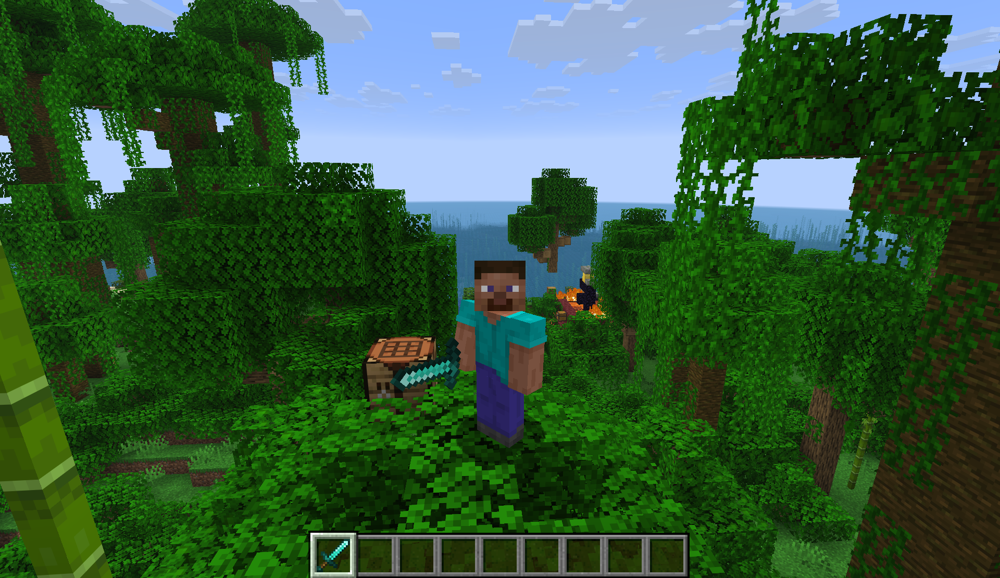
- **"MineCorp is a game."** A short slide, one beat. First time the game is named.
- Why a game works as a test domain: public data, real complexity, answers you can check, nothing real at risk.
- And the point: the pattern did not change when the domain was named. Swap the names and it is your catalogue and your runbooks.
- **Visual:** a screenshot of the game: the character holding a diamond sword, with a crafting table in the background. It is the first game screenshot in the deck, so the naming rule's "screenshots wait" now starts here. It echoes the diamond sword of slide 4. Then straight into the demo.

### 22. Live demo (about 7 minutes)
Planned order; each step makes one point.

Say before step 1: the agent can only read; it cannot change anything. The tools and the build come after the demo (slides 23 to 28), so say what each step is showing and promise to open it up afterwards.

1. `/agent what do I need for a diamond pickaxe?` the domain graph, a recipe route.
2. `/agent where do I find diamonds?` the world graph (ore heights, biomes).
3. `/agent how do I get to the Nether?` a process, labelled as a draft, with the wiki pages it came from.
4. `/agent what does sharpness do?` the lexical graph and the bridge.
5. `/agent-explain` the book: sources and graph paths.
6. A follow-up ("and how many of those do I need?") memory and context.
7. Neo4j Browser: the same path in the graph (the pattern in the book is a query that returns it).

Fallbacks: the terminal stub (`chat-with-agent.ps1 -Trace`) if the client or server fails; screenshots on a hidden slide.
To decide: the comparison against prompt-stuffing and retrieval that the CFP promises (the same question through each).

## Part 6. Build and govern (takeaway 4)

### 23. Build from source

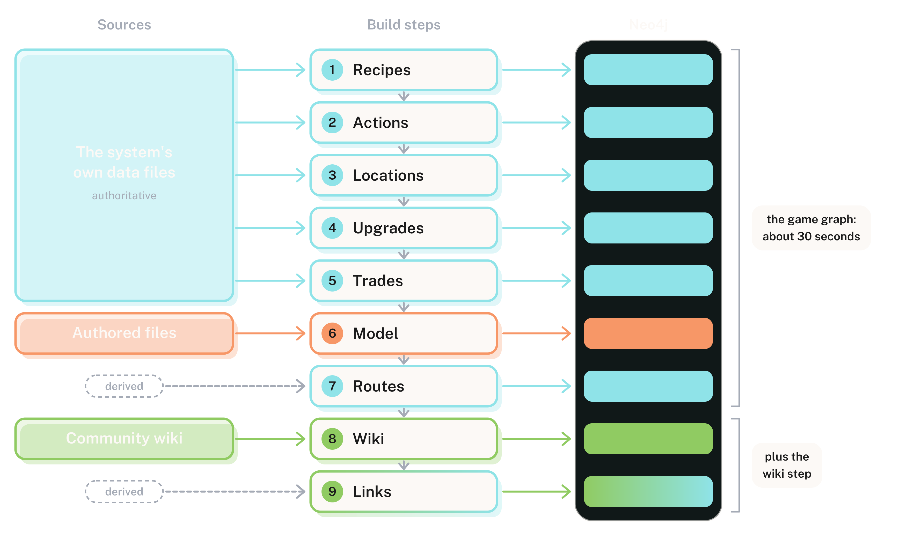
- The graph can be rebuilt from the source data and the authored files in about 30 seconds, plus the wiki step.
- Loaders may wipe and recreate what they own; only history and memory are not rebuildable.
- **Visual:** the build order as a line: recipes, actions, locations, upgrades, trades, model, routes, wiki, links.

### 24. The model as a checked spec

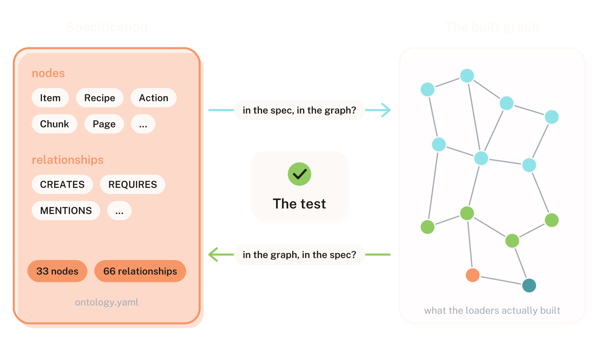
- The ontology is also written as data (33 nodes, 66 relationships) in the Neo4j Ontology Graph Specification.
- A test compares the spec with the real built graph in both directions, so the code and the model cannot drift.
- It found real gaps in the first draft.
- **Visual:** spec on the left, graph on the right, the test between them.

## Part 7. The agent (takeaway 2)

### 25. The agent and its tools

- **The agent is small on purpose:** one service in its own process, a hand-written loop (no framework) around a language model. The model reads the question, picks a tool, reads the result, and repeats until it can answer. The knowledge stays in the graph, not in the prompt.
- **The model never writes a query.** It chooses a tool; the tool decides the Cypher. That is the access control: the agent can only do what the tools allow, and they only read.
- **Purpose-built, read-only tools** (11), in four groups:
  - find things: `find`, `list`, `members`
  - the domain: `get_recipes`, `what_do_i_need`, `how_to_get`, `where_to_find`, `describe`
  - processes: `get_process`
  - the wiki: `search_wiki`, `read_section`
- **Tools are written to be used by a model:** each one's rules are in its description, not in the prompt; a name that fits several things comes back as candidates; every result has a size budget and drops whole entries rather than cutting the JSON; a failure is a typed error (fix and retry, service down, unexpected) the model can act on.
- **Context and trace:** the last three exchanges go in with a new question so "it" and "those" resolve; every run is recorded as a trace (slide 19).
- **Visual:** a loop diagram, left to right. The question on the left; in the middle the model with an arrow out to a tool and an arrow back with the result, drawn as a loop; the tools below it in their four groups. On the right, the graph the tools read (the three graph colours from slide 13), with one real path highlighted. Out at the bottom: the answer and its sources (leading into slide 26). Label the loop "the model chooses, the tool queries".

### 26. Sources, graph paths, and transparency

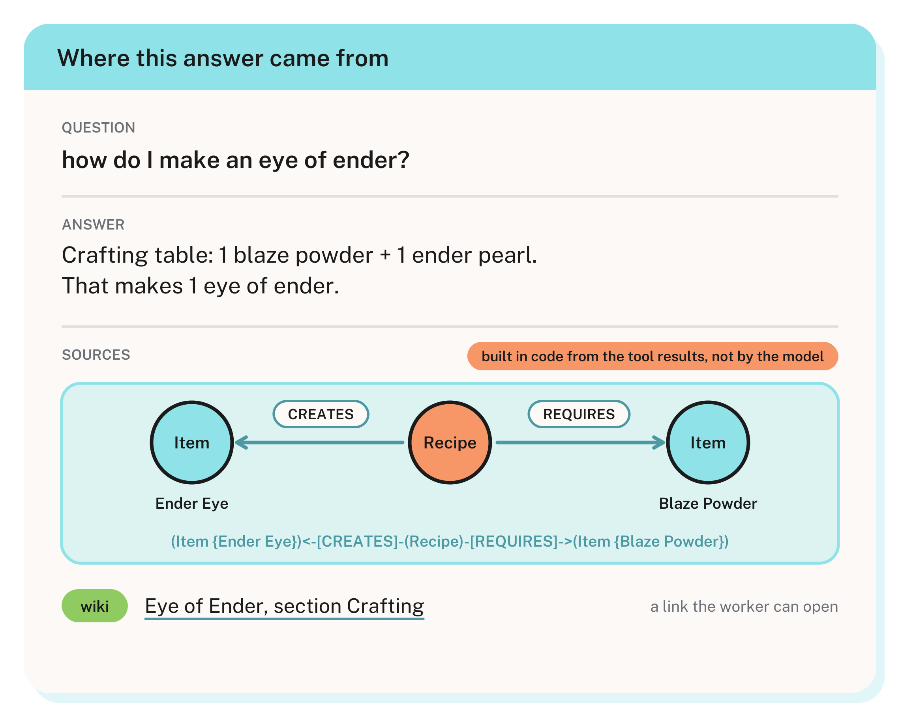
- Each answer carries its sources, built in code from the tool results (never by the model), plus the graph pattern the tool walked.
- The worker can ask for them and gets a panel with the question, the answer and the sources.
- **Business parallel:** the answer comes with its evidence.
- **Visual:** a mock-up of the panel (text and one highlighted pattern), not a screenshot. The real book was seen in the demo (slide 22, step 5), so this slide explains how it is made.

## Part 8. Test and evidence (takeaways 1 and 4)

### 27. Testing the agent: questions with checks

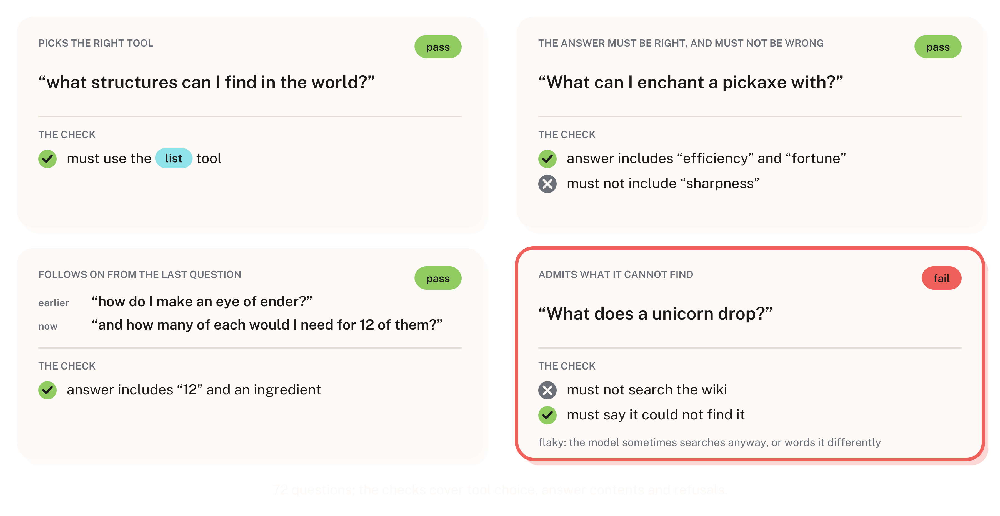
- A test set of 72 real questions, asked of the real model. Each one states two things: **which tool the agent should reach for**, and **what the answer must contain, or must not**.
- This is how you know a change helped and did not break something else. Without it, every prompt or tool tweak is a guess.
- Some tests are known to be flaky because the model varies, and that is stated rather than hidden.
- Wording: say "test" and "check", not "evals". If the term is needed, say "these are usually called evals" once, as an aside (slide 28 uses a failed test as its story).
- **Visual:** a short list of real tests as cards, each with the question, the check and a result, with one red. Use three or four (the file is `agent/evals/questions.json`):

| Test (what it proves) | Question | The check | Result |
|---|---|---|---|
| Picks the right tool | "what structures can I find in the world?" | must use the `list` tool | pass |
| The answer must be right, and must not be wrong | "What can I enchant a pickaxe with?" | answer includes "efficiency" and "fortune"; must not include "sharpness" | pass |
| Follows on from the last question | earlier: "how do I make an eye of ender?"; now: "and how many of each would I need for 12 of them?" | answer includes "12" and an ingredient | pass |
| Admits what it cannot find | "What does a unicorn drop?" (there is no such creature) | must not search the wiki; must say it could not find it | red (flaky: the model sometimes searches anyway, or words the refusal differently) |

  - The red card is honest (that test is known to flake) and it leads into slide 28. The unicorn test needs the item to be explained as "a thing that does not exist"; no game knowledge is needed.
  - Alternative red cell: the wool test ("what is the recipe for getting wool", the check requires "string"), which failed before the fix on slide 28. Use it if slide 28 is shown, so the audience sees the failing check and then its story.
  - Add a footer line: "72 questions; the checks cover tool choice, answer contents and refusals."

### 28. What went wrong

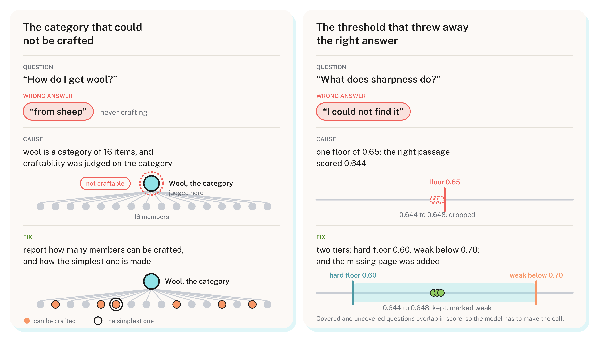
- **The threshold that threw away the right answer.** "What does sharpness do?" answered "I could not find it". The agent had searched the wiki, but a single score floor of 0.65 dropped passages that scored 0.644 to 0.648. Fixed with two tiers (hard floor 0.60, weak below 0.70), and the missing page (the one that lists what each upgrade does) was added. Measured: covered and uncovered questions overlap in score, so the model has to make the call.
- **The category that could not be crafted.** "How do I get wool?" answered "from sheep", never crafting, because wool is a category and craftability was judged on the category node. Fixed by reporting how many members can be crafted, and how the simplest one is made.
- **Visual:** one slide with two columns: the question, the wrong answer, the cause, the fix.
- Wording: show the item names (Sharpness, Wool) but do not explain them; the lesson is the threshold and the category, not the game. Say "the right passage scored 0.644" and "wool is a category of 16 items".

### 29. Does it pay off? Interim results

- The data for Minecraft is publicly available, a recent LLM should contain this information in its training data.
- Hypothesis - a small model with the knowledge layer performs as well as a large model

- **Headline:** a small model with the knowledge layer answered every question; the large model on its own missed 1 in 12, at about five times the cost per right answer.
- **Interim, indicative results**: 60 questions about the system's own data, each asked 3 times of each setup (720 runs).

| | Small + graph | Small | Large | Large + graph |
|---|---|---|---|---|
| Right answers (of 180) | **180 (100%)** | 124 (69%) | 165 (92%) | 180 (100%) |
| Cost per right answer | **$0.0009** | $0.00025 | $0.0048 | $0.060 |
| Cost compared with small + graph | **1x** | 0.3x | 5.3x | 66x |

- **Caveat on the slide, in plain words: these results are indicative, not conclusive.** One benchmark, 60 questions, two models, one run. The answers are checked against the same graph the agent reads, so this shows the agent retrieves this system's data faithfully, not that the data is right. A different question set could narrow the gap or reverse it.
- **Visual:** the table above, large, with the "Small + graph" column highlighted in the domain colour and an "indicative" stamp or ribbon across a corner so it cannot be read as a finding. Keep the four columns in this order (small + graph, small, large, large + graph) so the eye goes from the claim to the alternatives. Under it, one line of small print: "Small = GPT-6 Luna, large = GPT-6.2 Astra; same settings for both; cost at list price; multiples are cost per right answer; run of 2026-11-18."
- **Say it as a story, not a league table:**
  - The small model alone is cheap and often wrong (69%); giving it the graph lifts it to the large model's level and beyond for about a fifth of the large model's cost per right answer.
  - The large model alone is good (92%) but not exact. Its misses are all figures that sit close to the truth and are wrong: what a trader charges for a cake (it says 1, the data says 3), how many kinds of creature spawn in the desert (12; the data says 14).
  - Giving the large model the graph gains accuracy but at a dearer price per right answer, so the interesting comparison is the first column against the third.
  - On common knowledge (a recipe, a well-known level) every setup got nearly everything right; the graph earns its place on exact figures, counts and joins.
- **If asked how sure we are:** the gap between small + graph and large alone is 8 points, with a 95% interval of 2 to 16 (resampling the questions). That is a real but modest gain measured on a small set, which is why the slide says indicative.
- **If asked about fairness:** the large model alone did know the newest content (it scored every new-content question right), so this is not a story about out-of-date training data. The graph's edge is exactness. And one early failure was the agent's own: it could not say how many times a trade can be made because no tool returned it, which the benchmark found and the team fixed (a good small example of testing, slide 27).
- **Cost note:** the cost per right answer for the graph columns assumes list price. With the provider's prompt cache the small + graph figure is about four times lower again (the large + graph one about two times), but that needs steady traffic, so quote the list price.
- Source and detail: [benchmark.md](benchmark.md) (run 20261118-170033; reproduce with `./scripts/run-benchmark.ps1`). Re-run before presenting if the data, the agent or the prices have changed, and update the table. The numbers here are from the run of 2026-11-18.
- Naming: after the reveal (slide 21), so the game's own terms are fine in the notes; on the slide keep "the system's own data".

## Part 9. Close

### 30. Four takeaways

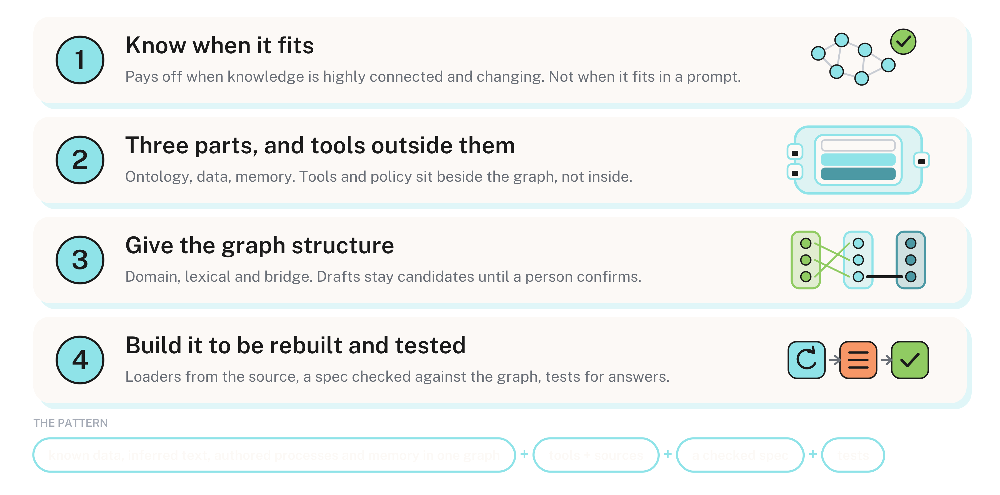
- Four takeaways:
  1. **Know when it fits.** A knowledge layer pays off when your knowledge is large, connected and changing, and it comes from several sources. It does not when the data is small and stable enough to sit in a prompt, there is a single source with nothing connecting it, or no one will own the model.
  2. **Three parts, and tools outside them.** An ontology, the data that fills it, and memory. The agent's tools and policy sit in an access layer beside the graph, not inside it.
  3. **Give the graph structure.** Domain, lexical and bridge: what is known, what the text says, and the links between them. Mark what is drafted as a candidate until a person confirms it.
  4. **Build it to be rebuilt and tested.** Loaders from the source of truth, a spec checked against the graph, and tests for the agent's answers.
- **The pattern:** known data, inferred text, authored processes and memory in one graph; read-only tools; a checked spec; tests.
- **Fits any domain** built on catalogues and processes: runbooks, supply chains, support, operations.
- **Visual:** four numbered cards or rows. Reuse the icon style of the diagrams: takeaway 2 uses the three-part picture from slide 12, takeaway 3 the three graph colours from slide 13. Neutral wording, since the game was named at the reveal and this slide is about the pattern.

### 31. Thank you

[github.com/martinohanlon/minecorp]](https://github.com/martinohanlon/minecorp)


[linkedin.com/in/martinohanlon](https://linkedin.com/in/martinohanlon)


---

## Adapting to the audience

The structure and the demo stay. The parallels and the depth change.

| Audience | Emphasise | Trim |
|---|---|---|
| Developers | architecture, tools, the loader and spec test, the agent tests, the failure stories; show more Cypher | business parallels |
| Architects | the three parts, the access layer, candidate versus confirmed, rebuild from source | tool detail |
| Technical leaders | the use case, the enterprise parallels on each graph slide, governance, the "when not" line on the closing slide | Cypher, loader detail |

When to reveal the game (slide 21):

| Audience | Reveal |
|---|---|
| Technical leaders, mixed or business-leaning events | at slide 21, before the demo (the default) |
| Architects | at slide 21 |
| Developers, or an event where the game is part of the draw | as early as slide 4; the visuals then name the game and the naming rule is dropped |
